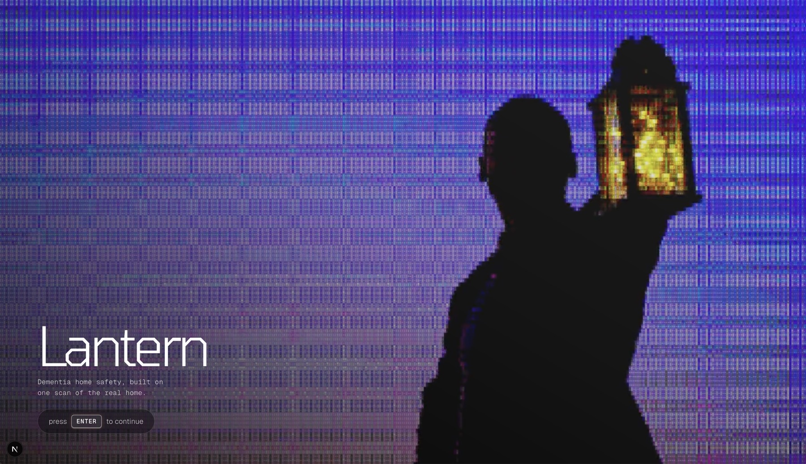
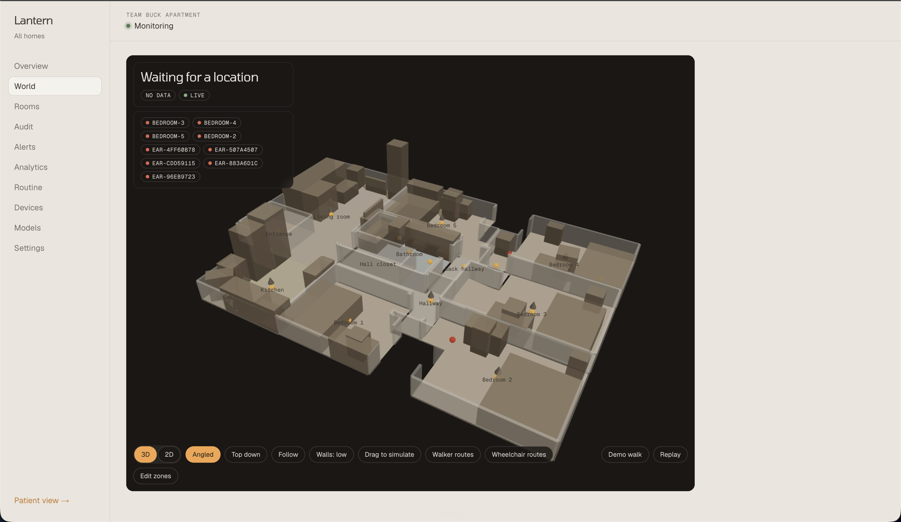
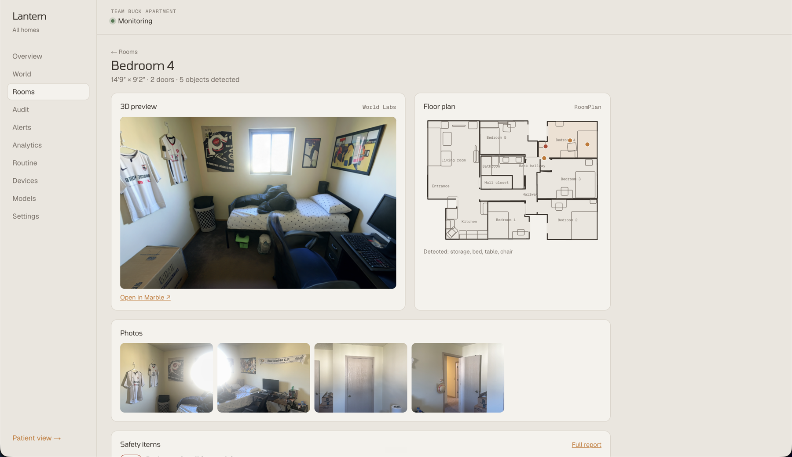
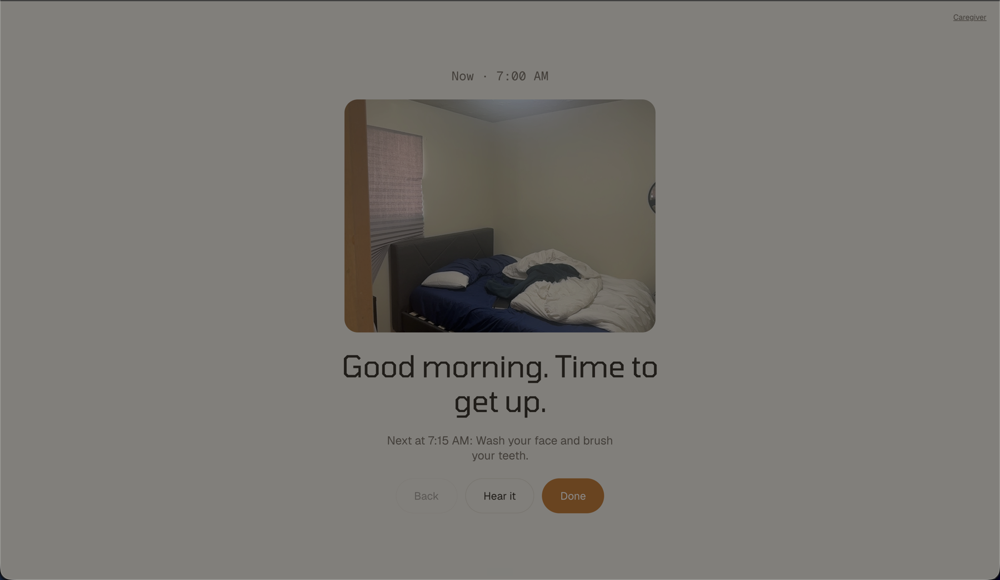
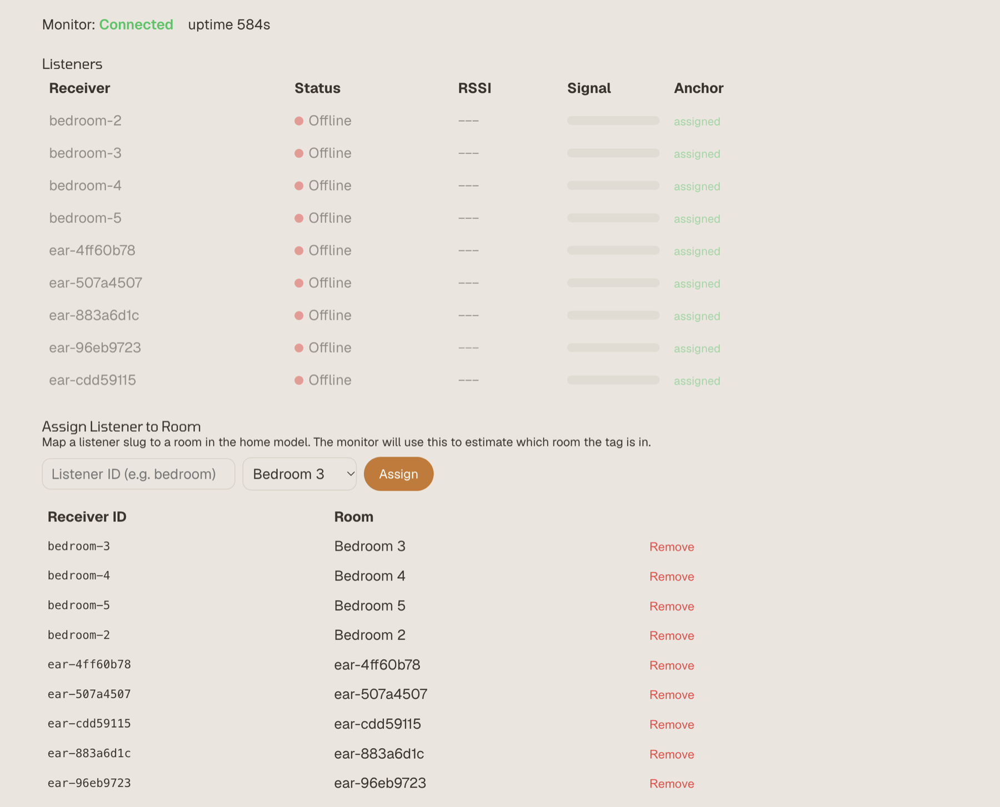
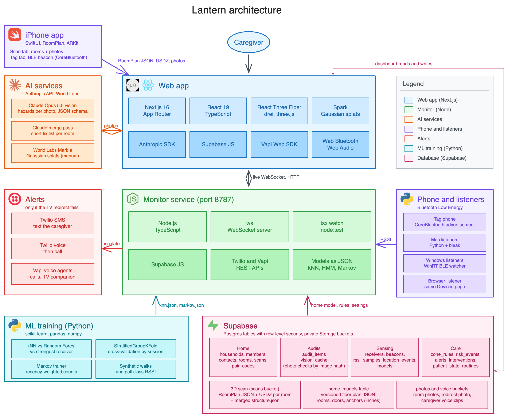

# Lantern

Dementia home safety built on one scan of the real home. Built for Hack Ohio 2026.

A caregiver scans the home once with an iPhone. Lantern turns that scan into a to-scale model of the home, audits
it for hazards and accessibility, and follows the person from room to room with a Bluetooth tag. When something
risky happens, such as heading for the front door at 3 AM, Lantern responds in that room first, with a soft glow, a
familiar photo and a calm voice. It contacts the caregiver only if that does not work.

Lantern assists caregivers. It does not replace supervision and is not a medical device.



## What it does

| Feature | How it works |
|---|---|
| Scan | The iPhone app (Swift, RoomPlan, LiDAR) measures every wall, door and piece of furniture. Apple's StructureBuilder stitches the rooms into one home |
| Hazard audit | Claude reviews every room photo for risks (missing grab bars, fall risks, medication left out) and merges them into a short list per room, each with a suggested fix and rough cost |
| Accessibility audit | ADA rules on the scan's measurements: door and hallway widths, turning space, and a walker or wheelchair route through every doorway |
| 3D views | A to-scale three.js model of the home, and World Labs Marble rooms made from the photos |
| Home monitor | Room laptops hear the tag. The dot goes on the walking route between the nearest sensors, a door-graph HMM keeps the room steady, and a Markov model predicts the next room |
| Redirect and alerts | Risk rules per room and time of day. A screen in the room glows and speaks first, then the caregiver gets a push (ntfy), a text and a call (Twilio or Vapi) |
| Familiar routine | A Now and Next daily guide on the patient screen, built from photos of the person's own rooms |

<table>
  <tr>
    <td></td>
    <td></td>
  </tr>
  <tr>
    <td align="center">The scanned home in 3D, with sensors and walker and wheelchair routes</td>
    <td align="center">A room: World Labs preview, RoomPlan floor plan and photos</td>
  </tr>
  <tr>
    <td></td>
    <td></td>
  </tr>
  <tr>
    <td align="center">The patient screen: Now and Next, with a photo of their room</td>
    <td align="center">Devices: each listener and the room it stands in</td>
  </tr>
</table>

## Why not just cameras?

Cameras are the usual answer, but a camera only records what happened. Someone still has to be watching, and at
3 AM the caregiver is asleep. Motion alerts go off for everything, so people learn to ignore them. And most
families won't put a camera in a bedroom or bathroom, which is where a lot of the risk is.

We went the other way. Lantern only knows which room someone is in, not what they look like or what they're doing.
It knows the rules of the home ("the kitchen at night", "near the front door"), and it acts first: a calm voice
and a familiar photo in that room, guiding them back to bed. The caregiver only gets woken if that doesn't work.

## What we struggled with

Getting Bluetooth to work reliably took most of the weekend. The signal from a phone bounces off walls, drops
when it's in a pocket, and reads 8 to 15 dB differently on two laptops sitting side by side. Our first room
classifier was trained on simulated data and fell apart in a real apartment, and the dot on the map kept jumping
between rooms.

We got there by debugging it one problem at a time:
- **Phones stopped broadcasting** when the screen locked, so the tag runs with Auto-Lock off and Guided Access on.
- **Laptops disagreed** about the same signal, so we added per-laptop calibration offsets.
- **Readings went stale**: a listener kept re-sending its last value after the phone walked away, so readings now
  expire.
- **The dot jumped around**, so we smooth each sensor over a few seconds and place the person on the real walking
  route between the two nearest sensors, with a door-graph model that only allows moves through real doorways.
- **Browsers blocked the live feed** between https pages and the monitor, so the web app now relays it.

It still isn't perfect, and the dot occasionally cuts through a wall. But it follows a real person through a real
apartment, and that took a lot of late-night walking up and down the hallway.

## How it fits together



- **Web app** (`app/`, `lib/`): Next.js, React, TypeScript, plain CSS. Dashboard, scan pipeline, audits, Tracking
  page and the patient screen.
- **Monitor** (`monitor/`): Node service. Takes in readings, works out the room and position, runs the risk rules
  and the responder, and streams live state.
- **Listeners**: room laptops join from the Tracking page (Chrome Web Bluetooth, or a one-line terminal command it
  gives you). Readings go to Supabase and the monitor relays them in. The Python scripts in `listener/` report to
  the monitor directly.
- **iPhone app** (`ios/`): SwiftUI. The Scan tab maps rooms; the Tag tab broadcasts the Bluetooth signal.
- **ML** (`ml/`): training for the kNN room classifier and the next-room predictor. A kNN model only fits the home
  it was trained on, so a newly scanned home uses the floor grid instead.

Edit the diagram in `docs/architecture.excalidraw` and export it again as `docs/architecture.png`.

## Run it

Needs Node 20+, and optionally a Supabase project (without keys the web app runs on demo data), Python 3 for the
listeners and ML, and a LiDAR iPhone plus Xcode for scanning.

```bash
npm install
cp .env.example .env.local     # fill in what you have
npm run check-env              # what is configured and what answers (never prints secrets)

npm run dev:monitor            # monitor on http://localhost:8787
npm run dev                    # web app on https://localhost:3000, reachable from other devices
```

Then open `/dashboard` for your homes, `/dashboard/new` to add a home and pair the iPhone app, and
`/routine?room=<room id>` for the patient screen (fullscreen on a tablet or laptop in that room; tap once for audio).

**Without hardware:** `npm run dev:mock-walk` walks a pretend person through the loaded home, and the Devices page
has simulator buttons. Set `DEMO_HOUR=3` on the monitor to play the night story during the day.

**With hardware:**
1. Build the iPhone app (`ios/README.md`), pair it, scan each room with 2 to 4 photos, and upload.
2. On each room laptop, open the hub's `/dashboard/tracking` in Chrome, pair it and place it in its room.
3. Start the tag in the iPhone app's Tag tab, with Guided Access on.

See `docs/runbook.md` for demo-day startup and fixes for common problems.

## Environment

Copy `.env.example` to `.env.local`. Only the Supabase keys are needed; the rest turn on single features.

## Development

```bash
npm run typecheck   # web and monitor
npm test            # node:test via tsx, lib/** and monitor/**
npm run build       # stop npm run dev first, or .next gets corrupted
```

```
app/         routes: landing, dashboard, API, /routine (patient screen), /signs (door signs)
lib/         types, home model, audits, cues, dashboard data
components/  3D scene
monitor/     sensing, inference, actions, world
listener/    Python BLE listeners
ios/         iPhone app (XcodeGen spec in ios/project.yml)
ml/          training scripts and saved models
supabase/    migrations and seed data
fixtures/    sample scans, readings and the demo home model
tools/       dev helpers (mock-walk, mock-rssi, check-env, calibrate-offsets, position-eval)
docs/        runbook, status, cue wording, Vapi setup
images/      screenshots for this README
```
